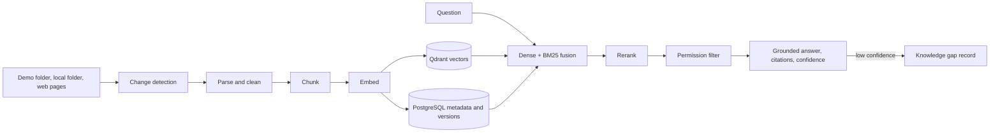

# KnowledgeOps

KnowledgeOps keeps an internal RAG knowledge base fresh. It finds documents, re-embeds only what changed, answers questions with hybrid search and citations, refuses when the evidence is thin, and logs every unanswered question as a knowledge gap. It is for teams whose policies and runbooks change often and who are tired of chatbots that go stale or make things up.

> **Heads up (checked 1 Nov 2026):** the `app/db/models` package is missing from this repository. The `.gitignore` rule `models/` (meant for downloaded model weights) also matched `app/db/models/`, so the database models never got committed. Every test, the CLI ingest and the API need that package, so a fresh clone cannot run end to end until it is restored. The `.gitignore` rule is now fixed so it only ignores the top level `models/` folder. See [Status](#status).

## What it does

- **Incremental ingestion.** Content hashes mark each document NEW, UNCHANGED, MODIFIED or DELETED, so only changed documents are re-chunked and re-embedded.
- **Version history.** Every change creates a new document version, and citations carry the version they came from.
- **Hybrid retrieval.** Dense search in Qdrant plus BM25 keyword search, fused and then reranked by a local cross encoder.
- **Permission filtering.** Chunks carry `allowed_groups`, and anything the user's group cannot see is removed before it reaches the generator.
- **Grounded answers.** Answers are built only from retrieved evidence, with citations and a confidence score worked out from retrieval signals.
- **Knowledge gaps.** When confidence is too low, the question is stored with its best score and how often it is asked, so content owners know what to write next.
- **Evaluation.** A 60 question benchmark (`evals/datasets/main_eval.json`) with saved baselines and quality gates.
- **Interfaces.** FastAPI REST API, a small Jinja dashboard and a Typer CLI. Ingestion can also run as a Prefect flow with retries.

Formats: PDF, DOCX, Markdown, TXT and HTML. Embeddings use `sentence-transformers/all-MiniLM-L6-v2` locally, so no paid API is needed. Generation defaults to a mock provider; an Ollama provider is included for a real local LLM.

## How it works



Retrieval settings live in `config/retrieval.yaml`: 20 dense and 20 BM25 candidates, 30 after fusion (alpha 0.5), 8 after reranking, 5 passed to the generator. Answers below a confidence of 0.35 are refused and logged as gaps.

Diagrams of every flow are in [ARCHITECTURE.md](ARCHITECTURE.md). Design decisions are recorded in [docs/decisions](docs/decisions):

| ADR | Topic |
| --- | --- |
| [001](docs/decisions/001-qdrant-vector-store.md) | Qdrant as the vector store |
| [002](docs/decisions/002-hybrid-retrieval.md) | Hybrid dense and sparse retrieval |
| [003](docs/decisions/003-provider-abstraction.md) | Provider abstraction |
| [004](docs/decisions/004-document-versioning.md) | Content hash versioning |
| [005](docs/decisions/005-rag-quality-gates.md) | RAG quality gates |
| [006](docs/decisions/006-permission-filtering.md) | Permission filtering |

## Quick start

You need Python 3.12 or newer, plus Docker for PostgreSQL and Qdrant. **This will not work on a fresh clone until `app/db/models` is restored** (see the note at the top).

```bash
git clone https://github.com/TEHILLA-O/knowledgeops.git
cd knowledgeops
python -m venv .venv && source .venv/bin/activate
pip install -e ".[dev]"
cp .env.example .env

docker compose up -d postgres qdrant   # PostgreSQL on localhost:15432, Qdrant on localhost:6333
make setup                             # prepares the demo knowledge base
make migrate                           # Alembic migrations
knowledgeops ingest --source demo
knowledgeops api                       # API docs at http://localhost:8000/docs, dashboard at /dashboard
```

What was verified on 1 Nov 2026 (Linux, Python 3.12): `pip install -e ".[dev]"` succeeds and `knowledgeops --help` lists all commands. Nothing past that could run because of the missing models package, and Docker was not available on the test machine.

The full stack (app, PostgreSQL, Qdrant) is `docker compose up -d`. PostgreSQL uses port 15432 on purpose so it does not clash with a local install.

## Usage

```bash
knowledgeops demo                            # 20 step case study walkthrough
knowledgeops ingest --source demo
knowledgeops query "What is the VPN policy?"
knowledgeops search "leave policy"           # retrieval only
knowledgeops documents
knowledgeops gaps
knowledgeops evaluate --dataset main_eval --top-k 5
knowledgeops benchmark
knowledgeops status
knowledgeops api
```

API (base `http://localhost:8000/api/v1`):

| Endpoint | Method | What it does |
| --- | --- | --- |
| `/query` | POST | Grounded answer with citations |
| `/search` | POST | Retrieval only |
| `/documents` | GET | Indexed documents |
| `/documents/{id}/versions` | GET | Version history |
| `/ingestion/run` | POST | Start an ingestion run |
| `/ingestion/runs` | GET | Run history |
| `/knowledge-gaps` | GET | Unanswered questions |
| `/evaluations/run` | POST | Run the benchmark |
| `/analytics/summary` | GET | Usage summary |
| `/health` | GET | Health check |

```bash
curl -X POST http://localhost:8000/api/v1/query \
  -H "Content-Type: application/json" \
  -d '{"query": "How many vacation days do employees get?", "user_group": "ENGINEERING"}'
```

## Results recorded so far

These numbers come from [BUILD_REPORT.md](BUILD_REPORT.md), dated 26 Aug 2026, when the models package still existed locally. They have **not** been re-run since and cannot be reproduced from this repository until the models are restored.

| What | Recorded value |
| --- | --- |
| Demo corpus | 40 documents, 662 chunks on first ingest |
| Second ingest | 40 unchanged, 0 chunks re-embedded |
| `main_eval` (60 questions, k = 5) | MRR 0.625, Hit Rate 0.633, Precision 0.573, Recall 0.633, NDCG 0.702 |
| Quality gates | Hit Rate at 5 of at least 0.6 and MRR of at least 0.5, both passed |
| Latency on CPU (3 runs) | Hybrid retrieval about 1.1 s, full query about 1.6 s |
| Tests | 49 passed, 72% coverage |

The answers in those runs came from the mock generator, so the evaluation measures retrieval quality, not answer quality.

## Tests

```bash
make test         # or: make test-unit, make test-integration, make test-e2e
make lint         # ruff
make typecheck    # mypy
```

On 1 Nov 2026 the suite could not start: `tests/conftest.py` imports `app.db.models`. With the conftest skipped, 11 unit tests (citations, confidence, permissions) passed and the other 6 unit test files failed to import for the same reason. Ruff reports 13 issues, 12 of them auto fixable. The GitHub Actions workflow has been failing since September for the same reason.

## Configuration

| File | Purpose |
| --- | --- |
| `.env` (from `.env.example`) | Database and Qdrant URLs, provider choice (`EMBEDDING_PROVIDER`, `GENERATION_PROVIDER`, `RERANKING_PROVIDER`), Ollama URL, default user group |
| `config/ingestion.yaml` | Sources, chunk size (512 tokens, 64 overlap), batch size |
| `config/retrieval.yaml` | Top k values, fusion weight, confidence thresholds, quality gates |

CI runs with `EMBEDDING_PROVIDER=mock`, `GENERATION_PROVIDER=mock`, `RERANKING_PROVIDER=none` and an in memory SQLite database, so no keys or downloads are needed for tests. Never put real API keys in `.env.example`.

## Project structure

```text
app/
  api/routes/       REST endpoints
  cli/              Typer CLI
  dashboard/        Jinja dashboard
  db/               Session (models package missing, see above)
  evaluation/       Metrics, runner, regression checks
  generation/       Grounded answers, citations, confidence, mock and Ollama providers
  ingestion/        Discovery, change detection, parsers, chunking, pipeline
  knowledge_gaps/   Gap tracking
  providers/        Embedding and reranking providers
  repositories/     Data access
  retrieval/        Dense, BM25, hybrid fusion, reranking, permissions
  workflows/        Prefect flow
config/             ingestion.yaml, retrieval.yaml
demo_knowledge/     Demo documents (engineering, finance, HR)
docs/decisions/     ADRs
evals/datasets/     main_eval.json and baselines
migrations/         Alembic (the schema is in 001_initial.py)
scripts/            Demo, evaluation and benchmark scripts
tests/              unit, integration, e2e
```

## Limitations

- No API authentication. User groups are passed as a parameter, so permission filtering is a simulation, not real access control. [SECURITY.md](SECURITY.md) covers this.
- The default generator is a mock. Real answers need Ollama or another provider.
- Retrieval runs on CPU and takes around a second.
- Only tested on a 40 document demo corpus.
- mypy reported 16 errors when last run.

## What went wrong along the way

[FAILURES.md](FAILURES.md) covers what can go wrong, what actually broke, how it was fixed, and the results. [CASE_STUDY.md](CASE_STUDY.md) is the longer write up.

## Status

Not runnable from a fresh clone as of 1 Nov 2026 because `app/db/models` was never committed. The fix is to add that package back from the original working copy; the schema it must match is `migrations/versions/001_initial.py`. Once it is back, the next checks are: run the tests, confirm the recorded evaluation numbers, and get CI green.

## Licence

MIT. See [LICENSE](LICENSE).

More of my work: https://cv.omnitest.dev/
